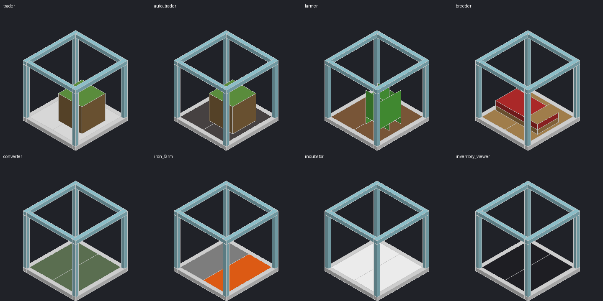

# Easy Villagers — conversão para Minecraft Bedrock (Android)

Conversão do mod **Easy Villagers 1.1.42** (Max Henkel, NeoForge, Minecraft Java 26.1)
para um addon do **Minecraft Bedrock 1.26.0+**, pensado para Android.

O mod coloca aldeões dentro de blocos compactos: comerciante, comerciante automático,
fazendeiro, criador, conversor, fazenda de ferro, incubadora e visualizador de inventário.



## Arquivos para instalar

| Arquivo | Uso |
|---|---|
| `release/EasyVillagers.mcaddon` | **Recomendado** — instala os dois pacotes de uma vez |
| `release/EasyVillagers_BP.mcpack` | Pacote de comportamento (sozinho) |
| `release/EasyVillagers_RP.mcpack` | Pacote de recursos (sozinho) |

## Instalação no Android

1. Baixe `EasyVillagers.mcaddon` no celular (ex.: pasta Downloads).
2. Toque no arquivo e escolha abrir com o **Minecraft**. O jogo mostra
   "Importação iniciada" e depois "Importado com sucesso" para os dois pacotes.
   - Se o gerenciador de arquivos não oferecer o Minecraft, renomeie para `.zip`,
     extraia e copie as pastas `EasyVillagers_BP` para
     `games/com.mojang/behavior_packs/` e `EasyVillagers_RP` para
     `games/com.mojang/resource_packs/` (no Android 11+ use o diretório que o
     próprio jogo indicar em Configurações → Armazenamento).
3. Crie ou edite um mundo → **Pacotes de Comportamento** → ative
   "Easy Villagers (Bedrock) BP". O pacote de recursos é ativado junto
   automaticamente (dependência).
4. **Nenhum experimento precisa ser ligado.** Requer Minecraft Bedrock **1.26.0 ou mais novo**.

## Como usar (resumo)

- **Pegar um aldeão:** agache e toque nele → vira o item *Aldeão* (guarda trocas, nível,
  nome e inventário). Use o item no chão para soltá-lo.
- **Colocar nas máquinas:** toque no bloco segurando o aldeão, a estação de trabalho,
  a semente ou os itens de entrada.
- **Retirar:** agache e toque com a mão vazia (retira estação/semente/aldeão na mesma
  ordem do mod original).
- **Menu:** toque com a mão vazia → mostra o estado e permite coletar a saída.
- **Comerciante:** toque no aldeão dentro do vidro para negociar.
- **Automação:** um baú/funil **embaixo** recebe a saída; um funil **em cima**
  apontando para baixo abastece as entradas.

Detalhes de cada bloco: `docs/inventario-original.md`. Diferenças em relação ao Java:
`docs/limitacoes.md`.

## Configuração (operadores)

```
/scriptevent easy_villagers:config                 lista as opções
/scriptevent easy_villagers:config farm_speed 5    altera uma opção
```

Lista completa em `docs/compatibilidade.md`.

## Situação

| | Encontrado | Convertido |
|---|---|---|
| Blocos | 8 | 8 (5 completos, 3 parciais) |
| Itens | 9 (+ entrada "bebê" da aba criativa) | 9 (+1 item para o bebê criativo) |
| Entidades | 0 | 0 (+1 entidade técnica de exibição) |
| Receitas | 7 | 7 |
| Loot tables | 7 | 7 |
| Idiomas | 16 | 14 (Bedrock não tem hr/lzh) |

Concluído / parcial / pendente: `docs/recursos-convertidos.md`.
**O addon ainda não foi testado dentro do jogo** — siga `docs/testes-manuais.md`.

## Estrutura do projeto

```
original/            JAR original (backup) e assets extraídos — não editar
source/              arquivos-fonte dos pacotes (behavior_pack/, resource_pack/)
tools/generate.py    gera blocos, itens, receitas, geometria, entidade, texturas e idiomas
tools/validate.py    validação estática e de referências cruzadas
tools/build.py       gera e verifica os .mcpack/.mcaddon
tools/preview_geometry.py  prévia da geometria (docs/img)
tools/lang/          textos de interface adicionados (en_US, pt_BR)
tests/               testes de regras + simulação da Script API
docs/                inventário, compatibilidade, limitações, testes, progresso
release/             pacotes instaláveis
```

Os scripts (`source/behavior_pack/scripts/*.js`) são escritos à mão; o restante de
`source/` é gerado — edite o gerador, não os JSON.

## Desenvolvimento

```
npm install                 # tipagens oficiais @minecraft/server 2.4.0 e TypeScript
python3 tools/generate.py   # regenera os pacotes a partir de original/
npm run typecheck           # verifica os scripts contra a API real
npm test                    # 25 testes (13 de regras + 12 de simulação)
python3 tools/validate.py   # referências cruzadas
python3 tools/build.py      # release/
```

## Licença e créditos

O mod original é © Max Henkel, "All rights reserved". Este addon reutiliza a textura
`farm.png`, as setas de interface, o ícone e as traduções do mod, e é destinado a uso
pessoal. Para distribuir publicamente, obtenha autorização do autor original.
Texturas de aldeão, zumbi, golem, blocos vanilla etc. não estão incluídas: o addon
usa as do próprio jogo.
